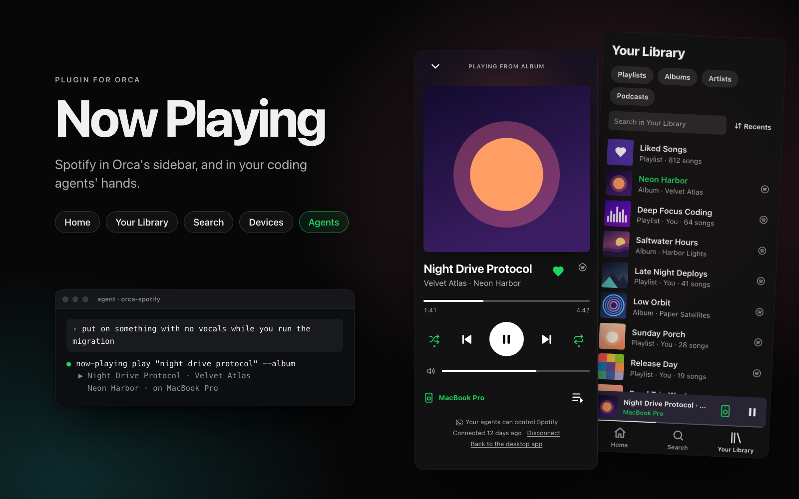
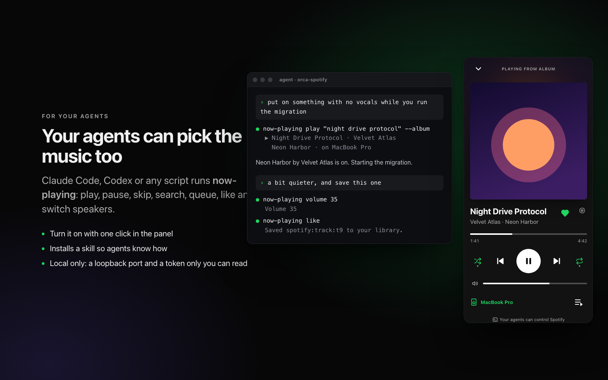
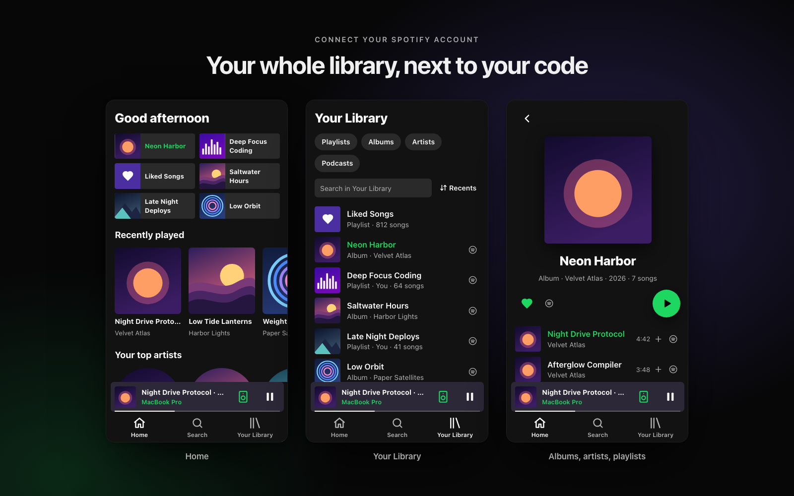

# Now Playing for Orca

Spotify in [Orca](https://github.com/stablyai/orca)'s sidebar, and in your coding agents' hands.
Home, your library, search, the queue and your devices sit next to your code; a status bar item
shows the song; and Claude Code, Codex or any script can play, pause, search and queue with the
`now-playing` command. Not affiliated with Spotify.

**[Open in Orca →](https://onorca.dev/plugins/bautistapessagno.now-playing)** &nbsp;·&nbsp;
share link: `orca://plugins/bautistapessagno.now-playing?catalog=community`



It reaches Spotify one of two ways:

- **The Spotify desktop app on macOS** (default on a Mac), through AppleScript. No Spotify
  account setup, API keys or Premium needed.
- **The Spotify Web API** (optional on a Mac). Controls whichever device you play on: desktop
  app, phone or speaker. Adds Home, your library, search, the queue and device switching. Needs
  Spotify Premium and a Spotify developer app of your own (5 minutes, below).

Pick one under Orca → Settings → Plugins → Now Playing → **Backend** (Auto, desktop app, Web API),
or with the links at the bottom of the panel.

## Install

Needs Orca 1.4.248 or newer.

1. Open [the plugin's page](https://onorca.dev/plugins/bautistapessagno.now-playing) and click
   **Open in Orca**, or in Orca: Settings → Plugins → search **Now Playing** in the community
   catalog. By hand: **Install plugin** → Git URL →
   `https://github.com/BautistaPessagno/orca-spotify#v0.4.0`.
2. Full-access plugins need Orca's separate setting that allows them (off by default).
3. Review what it asks for and click **Enable**. It asks for its own settings (the backend and
   your Client ID) and its own encrypted secrets (the Spotify login).

### macOS with the desktop app

The first time you use it, macOS asks whether Orca may control Spotify. Allow it. If you denied
the prompt: System Settings → Privacy & Security → Automation → Orca → turn on Spotify.

### Spotify Web API (Linux, Windows, or a Mac by choice)

Open the **Now Playing** panel; it walks you through these steps:

1. Have Spotify Premium. Spotify only lets Premium accounts control playback.
2. Create an app at [developer.spotify.com/dashboard](https://developer.spotify.com/dashboard).
   Pick "Web API" and accept the Developer Terms.
3. Add the redirect URI `http://127.0.0.1:43117/callback` to the app. If port 43117 is taken on
   your computer, change **Redirect port** in the plugin's settings and add that address instead.
4. Paste the app's **Client ID** into the panel (or into the plugin's settings). The Client ID is
   a public identifier, not a secret; nothing secret is ever pasted.
5. Click **Connect with Spotify**. Orca asks once whether the plugin may open
   accounts.spotify.com. Approve in the browser, then go back to Orca.
6. Open Spotify on any device. The player shows up.

Spotify ends the login every 6 months; the panel warns a month ahead and offers **Reconnect**.

Why your own app: Spotify's Development Mode caps each app at 5 users, so a shared Client ID
shipped with the plugin would stop working at the sixth person. If the account you log in with
is not the app's owner, add it to the app's user list on the dashboard.

On Linux, Orca stores the login in your keyring (gnome-keyring or KWallet). Without one, the
login lasts only until the plugin's worker stops (5 minutes idle) and the panel says so.

## Agents

Coding agents and scripts on your computer can control Spotify through the plugin:

```sh
~/.orca-now-playing/now-playing status
~/.orca-now-playing/now-playing play "dreams fleetwood mac"      # search, play the best song
~/.orca-now-playing/now-playing play "lofi beats" --playlist     # or --album, --artist
~/.orca-now-playing/now-playing play spotify:album:…             # a URI or open.spotify.com link
~/.orca-now-playing/now-playing pause | next | volume 30 | like | queue | devices
~/.orca-now-playing/now-playing help
```



Click **Let your coding agents control Spotify** at the bottom of the panel, or turn on
**Agent skill** in the plugin's settings, to install a `now-playing` skill for Claude Code
(`~/.claude/skills`) and Codex and other agents (`~/.agents/skills`). Then just ask: "put on
something calm", "skip this", "what's playing?". Turning the setting off removes the skill.

How it works: while the plugin is enabled its worker serves the panel's own requests on a
`127.0.0.1` port with a random token, and writes both to `~/.orca-now-playing/bridge.json`, which
only you can read. Browsers can't call it. `play <uri>`, pause, skip, volume and status work with
the desktop app on a Mac; search, the queue, devices and likes need the Web API. Turn it off with
**Agent access** in the plugin's settings. The CLI needs Node 20 or newer.

## Sidebar panel

Open **Now Playing** from the right sidebar's activity bar: cover, title, a seek bar,
play / pause, next, previous, shuffle, repeat and volume. It updates by itself while Spotify
plays. With the panel closed, the status bar shows the song.

With the Web API it also shows the device you're playing on (click it to switch), repeat with
three modes (off, all, this track), an "Open in Spotify" link, the heart, and Home, Search and
Your Library: your playlists, Liked Songs, albums, artists and podcasts, each with its own page.

 It reads Spotify less often (every 5 s while playing, 10 s paused,
30 s hidden) because the Web API is rate limited; the progress bar moves on its own in between.

| Feature                             | Desktop app (macOS) | Web API           |
| ----------------------------------- | ------------------- | ----------------- |
| Play, pause, skip, seek, volume     | yes                 | yes (Premium)     |
| Shuffle                             | yes                 | yes               |
| Repeat                              | on / off            | off / all / track |
| Open Spotify if it's closed         | yes                 | no                |
| Switch device                       | no                  | yes               |
| Queue, add to queue                 | no                  | yes               |
| Search, play an album or playlist   | no                  | yes               |
| Your playlists                      | no                  | yes               |

## Privacy

- **Stored on your computer:** the backend choice, your Client ID and the redirect port, in
  Orca's settings for the plugin; the Spotify login (access and refresh tokens), in the plugin's
  encrypted secrets file, protected by your OS keyring.
- **Sent:** only to Spotify (`accounts.spotify.com` to log in, `api.spotify.com` to control
  playback, Spotify's image servers for artwork). Nothing goes anywhere else.
- **Collected by the author:** nothing. There is no server, analytics or telemetry.
- **For agents:** `~/.orca-now-playing/` holds the CLI and `bridge.json` (local address and
  token, readable only by you; removed when the plugin stops). With **Agent skill** on, a
  `SKILL.md` in `~/.claude/skills/now-playing` and `~/.agents/skills/now-playing`.
- **Disconnect** at the bottom of the panel deletes the login. You can also remove the app's
  access at [spotify.com/account/apps](https://www.spotify.com/account/apps/).

## Develop

```sh
npm test                  # node:test, no dependencies
orca plugin validate .
orca plugin dev load .    # or Settings → Plugins → Development folders…
orca plugin logs local.now-playing
```

Use **Restart** on the plugin row after changing `worker.mjs`.

Layout:

- `orca-plugin.json`: manifest.
- `worker.mjs`: `activate(orca)`; builds both backends and wires the panel's handlers, the status
  bar item and the agent bridge to the backend selector.
- `src/backend.mjs`: what both backends share: command names, messages, the error type.
- `src/select-backend.mjs`: forwards to the backend the `backend` setting picks.
- `backends/applescript.mjs`: the desktop app, through `osascript`.
- `backends/webapi/`: the Web API. `auth.mjs` (login with PKCE, loopback redirect, tokens),
  `client.mjs` (requests, token refresh, rate limits), `backend.mjs` (player state and
  commands), `library.mjs` (devices, queue, search, playlists).
- `src/status-bar.mjs`: the status bar item; having one keeps the worker running.
- `src/agent-bridge.mjs`: the loopback server agents call, and `~/.orca-now-playing/bridge.json`.
- `src/agent-skill.mjs`, `agent/SKILL.md`: the skill installed for Claude Code and Codex.
- `bin/now-playing.mjs`: the `now-playing` CLI, copied to `~/.orca-now-playing/`.
- `src/panel-protocol.mjs`: the handlers the panel calls with `orca.plugin.request`.
- `src/settle.mjs`: waits for Spotify to apply a command before reading its state.
- `panel/index.html`: the sidebar panel.
- `images/`: the plugin directory's cover and screenshots; the cover is also the preview when
  someone shares the plugin's link. `node scripts/render-listing-images.mjs` renders them from
  the real panel with an invented catalog (needs Google Chrome, or set `CHROME`).

## License

MIT
