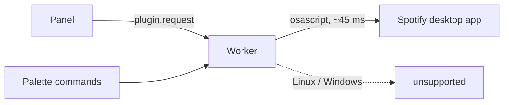
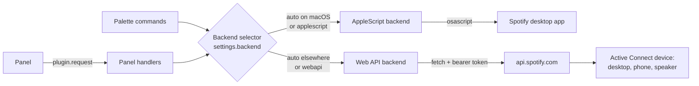
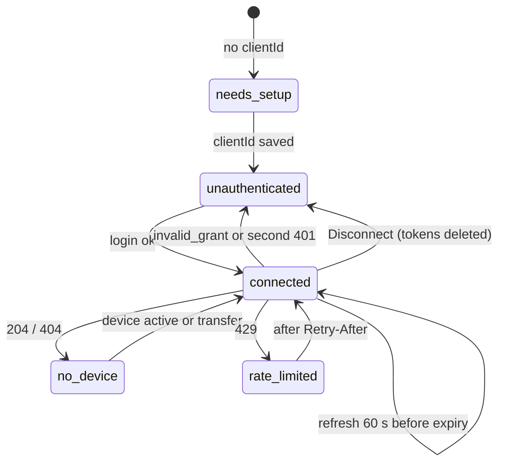

Artifact: https://claude.ai/artifact/TApnHbu1D63QxM5aBqjWvq

# Spec: Spotify Web API backend

Status: draft, 2026-11-02. Builds on [the Web API research](../../research/spotify-web-api.md) (2026-11-01). Plugin at 0.2.1, Orca 1.4.246 installed.

## Problem

Now Playing only works on macOS. Every call goes through `osascript` to the Spotify desktop app (`backends/applescript.mjs`). On Linux and Windows the panel and every palette command answer "unsupported".

AppleScript also caps what the panel can do. The desktop app's dictionary has no search, queue, playlists or devices, and repeat is a boolean. The panel can't grow past play/pause, seek, volume, shuffle and repeat on/off.



## Solution

Add a second backend that talks to the Spotify Web API, and put both behind one interface.

- **Linux and Windows:** Web API is the default. It's the only backend that runs there.
- **macOS:** AppleScript stays the default (no login, no Premium, no network). Users can switch to the Web API from Settings or from a link in the panel to get the full UI.
- The panel reads the active backend's `capabilities` and only draws what that backend supports.



### API key or OAuth?

OAuth. Spotify has no API key that can control a user's player.

- Playback, devices, queue and personal playlists all need a **user** access token. Only the Authorization Code flow gives one.
- The "key-like" option, Client Credentials (client ID + secret), returns an app token with no user attached. It can search the catalog but can't read or touch playback.
- For a desktop plugin Spotify recommends **Authorization Code with PKCE**: no client secret, so nothing secret ships or gets pasted.

So the user does two things: paste the **Client ID** of their own Spotify developer app (a public identifier, not a secret), then click **Connect with Spotify** and approve in the browser. The plugin keeps the tokens in Orca's encrypted `secrets` store.

Each user needs their own Spotify app because Development Mode caps a Client ID at 5 users and Extended Quota requires an organization with 250k MAU. A Client ID bundled in the repo would stop working at the sixth user and conflicts with the Developer Terms.

## User-facing behavior

### Backend setting

| `backend` value | macOS | Linux / Windows |
| --- | --- | --- |
| `auto` (default) | AppleScript | Web API |
| `applescript` | AppleScript | "unsupported" message |
| `webapi` | Web API | Web API |

### Setup on Linux / Windows (first open of the panel)

The panel opens on a setup view instead of the player:

1. Have Spotify Premium (playback control requires it).
2. Create an app at developer.spotify.com/dashboard. Pick "Web API". Accept the Developer Terms.
3. Add the redirect URI `http://127.0.0.1:43117/callback` (copy button in the panel).
4. Paste the Client ID into the panel field (also editable in Orca Settings).
5. Click **Connect with Spotify**. Orca asks once whether the plugin may open `accounts.spotify.com`. Approve in the browser.
6. Open Spotify on any device. The player appears.
7. Every 6 months the login expires (Spotify rule). The panel warns from month 5 and shows **Reconnect**.

### Opting in on macOS

The AppleScript player keeps working as today. A footer link "Search, queue and devices → use the Spotify Web API" opens the same setup view. Finishing setup sets `backend` to `webapi`. A "Back to the desktop app" link sets it to `applescript`.

### What the Web API UI adds

| Feature | AppleScript | Web API |
| --- | --- | --- |
| Play/pause, next, previous, seek, volume, shuffle | yes | yes (Premium) |
| Repeat | on/off | off → context → track |
| Seek precision | whole seconds | milliseconds |
| Open Spotify if closed | yes | no (Web API only sees running devices) |
| Device chip + switch device (transfer) | no | yes |
| Queue view + add to queue | no | yes |
| Search (tracks, albums, artists, playlists; 10 per page) | no | yes |
| Your playlists, play a playlist or album | no | yes |
| "Open in Spotify" link | no | yes (required attribution) |
| Save to Liked Songs | no | only if the endpoint is in the Dev Mode set (verify, phase 0) |

### Palette commands

Same five commands on every backend. With the Web API and no login, they answer "Open the Now Playing panel to connect your Spotify account." With no active device: "No Spotify device is active. Open Spotify on any device." Shortcuts already use `Mod`, which is Ctrl on Linux and Windows.

## Design

### Backend interface

`src/backend.mjs` holds what both backends share. Today `src/commands.mjs` and `src/panel-protocol.mjs` import `COMMAND_NAMES`, `MESSAGES` and `classifyError` from `backends/applescript.mjs`; those move here.

```js
Backend {
  id            // 'applescript' | 'webapi'
  capabilities  // see below
  settle        // { tries, stepMs } for runAndSettle
  getState()    // normalized state
  command(name, value)  // false when there is no player to send it to
}

capabilities = {
  repeatModes: ['off', 'context'] | ['off', 'context', 'track'],
  seekStepMs: 1000 | 1,
  volume: boolean,           // Web API: from device.supports_volume
  open: boolean,
  devices, queue, search, playlists, library: boolean,
  needsAuth: boolean,
  poll: { playing, paused, hidden }   // ms
}
```

Normalized state, a superset of today's:

```js
{
  backend: 'applescript' | 'webapi',
  status: 'playing' | 'paused' | 'stopped' | 'closed' | 'unsupported' | 'no-permission' | 'error'
        | 'needs-setup' | 'unauthenticated' | 'no-device' | 'rate-limited',
  message?, volume, shuffle,
  repeat: 'off' | 'context' | 'track',   // AppleScript maps true → 'context'
  track: { title, artist, artists?, album, uri, url?, durationMs, artworkUrl } | null,
  positionMs,
  device?: { id, name, type, supportsVolume },
  stale?, retryAfterMs?, authExpiresSoon?
}
```

`toggleRepeat` stays as a command name. AppleScript flips it; the Web API steps `off → context → track → off`. A new `setRepeat` command takes the mode directly.

### Backend selector

`src/select-backend.mjs` exposes the same `Backend` shape and forwards each call to the active backend. It reads `settings.get()` on each call. Orca has no settings-changed event, and the host call is local. When the active backend changes, the next `player.state` returns the new `backend` field and the panel resets.

`worker.mjs` builds both backends once and passes the selector to `createCommands` and `createPanelHandlers`, which don't change shape.

### Web API backend

```
backends/webapi/
  auth.mjs      PKCE, loopback callback server, token store
  client.mjs    fetch wrapper: token refresh, 401 retry, 429 gate
  backend.mjs   getState/command mapping (Backend interface)
  library.mjs   devices, transfer, queue, search, playlists
```

No Spotify SDK; plain `fetch`.

**Endpoints:** `GET /me/player`, `PUT /me/player/play|pause`, `POST /me/player/next|previous`, `PUT /me/player/seek|volume|shuffle|repeat`, `GET /me/player/devices`, `PUT /me/player` (transfer), `GET|POST /me/player/queue`, `GET /search`, `GET /me/playlists`. All are in the Feb-2026 Dev Mode set.

**Scopes:** `user-read-playback-state`, `user-modify-playback-state`, `user-read-currently-playing`, `playlist-read-private`. Spotify asks apps not to request scopes for later features. The playlist scope ships in the same release as the playlists view, or the scope list grows per phase and users reconnect once.

**Command mapping:**
- `playpause` reads `is_playing` first (there is no toggle endpoint).
- `toggleShuffle` sends `state=!shuffle_state`.
- `seek` takes seconds from the palette and ms from the panel; the Web API path keeps ms.
- `open` is not supported (capability `open: false`).

**Settle:** the Web API also says "order of execution is not guaranteed". Reuse `src/settle.mjs` with `settle: { tries: 2, stepMs: 400 }` instead of AppleScript's 6 × 80 ms.

### Login (Authorization Code + PKCE)

```mermaid
sequenceDiagram
  participant P as Panel
  participant W as Worker
  participant B as Browser
  participant A as accounts.spotify.com
  P->>W: auth.start (when setup view renders)
  W->>W: verifier, challenge, state; listen 127.0.0.1:43117
  W-->>P: authorize URL
  P->>B: click → orca.shell.openExternal(url)
  B->>A: user approves scopes
  A->>B: 302 to 127.0.0.1:43117/callback?code&state
  B->>W: GET /callback
  W->>A: POST /api/token (code + verifier)
  A-->>W: access, refresh, expires_in
  W->>W: secrets.set('spotify.tokens'), close server
  W-->>B: "Connected. Go back to Orca."
  P->>W: auth.status (polls every 1 s)
  W-->>P: connected
```

- The URL is built **before** the click: `openExternal` needs a click within a few seconds, and an awaited request could use that window up.
- The loopback server listens only during login and closes after the first valid callback or after 2 minutes. It validates `state`.
- Redirect URI uses `127.0.0.1` (Spotify forbids `localhost`). Default port 43117, changeable in Settings (`redirectPort`) if taken. If phase 0 shows the dashboard accepts a port-less loopback URI, switch to an ephemeral port and drop the setting.
- Tokens are one JSON secret: `{ access_token, expires_at, refresh_token, authorized_at, scopes }`.
- **Disconnect** button deletes the secret (Developer Policy requires an easy disconnect).

### Tokens, errors and rate limits



- **Refresh:** one shared promise, so two polls never refresh at once. Keep the old refresh token when the response has none.
- **401:** refresh and retry once. A second 401 → `unauthenticated`.
- **`invalid_grant` on refresh** (6-month expiry): delete tokens, `unauthenticated`, never retry.
- **403:** message names both causes: "Needs Spotify Premium, and your account must be on the app's user list."
- **204 or 404 no device:** `no-device`, with the device list and a **Play here** button per device.
- **429:** block requests until `Retry-After`, return the last state with `stale: true` and `retryAfterMs`. The panel already reschedules on `retryAfterMs`.
- **429 with `reason: "QUOTA_EXCEEDED"`:** pause 5 minutes, message "Your Spotify app's request quota ran out."
- **Linux without a keyring:** `secrets.protection()` returns `unavailable` and `secrets.set` fails. Keep tokens in worker memory and warn that the login lasts until the worker stops (5 min idle). Point to gnome-keyring or KWallet.

### Polling

Spotify publishes no rate-limit numbers. The budget is a rolling 30 s window shared by all of the user's Dev Mode apps.

| Situation | AppleScript | Web API |
| --- | --- | --- |
| Panel visible, playing | 1 s | 5 s, progress bar interpolated locally |
| Panel visible, paused | 1 s | 10 s |
| Panel hidden | 4 s | 30 s |
| After a command | settle 6 × 80 ms | settle 2 × 400 ms |
| Track end | n/a | one read at `duration − progress + 500 ms` |

The panel takes these from `capabilities.poll` instead of the hard-coded `POLL_MS` / `HIDDEN_POLL_MS`.

### Panel

`panel/index.html` is 503 lines of plain JS. The new views would roughly triple it. Split into ES modules served from the plugin origin (`panel/app.js`, `panel/views/*.js`) if phase 0 confirms the frame's CSP allows `script-src 'self'`; otherwise keep one file.

Views:
- **Setup:** steps above, Client ID field, copy button for the redirect URI, Connect button, keyring warning.
- **Player:** today's player, plus device chip, 3-state repeat icon, Spotify logo linking to the track (attribution), "Open in Spotify".
- **Tabs (Web API only):** Queue, Search, Playlists, Devices.
- **Footer:** backend switch link; Disconnect and connection age with the Web API.

New panel handlers in `src/panel-protocol.mjs`:

| Handler | Input | Returns |
| --- | --- | --- |
| `backend.info` | | `{ id, capabilities, connection: { clientId?, connected, authorizedAt, protection } }` |
| `backend.select` | `{ backend }` | `backend.info` |
| `auth.start` | `{ clientId? }` | `{ url }` |
| `auth.status` | | `{ status: 'pending' \| 'connected' \| 'failed', message? }` |
| `auth.disconnect` | | `{ ok }` |
| `player.devices` | | `Device[]` |
| `player.transfer` | `{ deviceId, play? }` | state |
| `player.queue` | | `{ current, queue: Track[] }` |
| `player.enqueue` | `{ uri }` | `{ ok }` |
| `player.playContext` | `{ contextUri?, uris?, offset? }` | state |
| `library.search` | `{ q, types, offset }` | results, 10 per type |
| `library.playlists` | `{ offset }` | `Playlist[]`, 50 per page |

All validate input: URIs must match `spotify:(track|album|playlist|artist|episode):[A-Za-z0-9]+`. `player.artwork` keeps its `i.scdn.co` allowlist; the Web API picks the ~300 px entry from `album.images[]`.

### Manifest

- `capabilities`: add `secrets:own`, `settings:own`. Existing installs show "Update needs review" and the user re-approves.
- `contributes.settings`:
  - `backend`: string, enum `auto | applescript | webapi`, default `auto`.
  - `clientId`: string, `maxLength: 64`, placeholder "Client ID from developer.spotify.com".
  - `redirectPort`: integer, default 43117, 1024 to 65535.
- `description`: "Control Spotify from Orca: the desktop app on macOS, or any device through the Spotify Web API. Not affiliated with Spotify."

### Spotify Developer Terms obligations (Web API backend only)

Controlling playback through the Web API counts as "Streaming" under the Developer Terms. The plugin must:
- work for Premium users only (Spotify enforces it with 403);
- stay free and non-commercial (it is MIT);
- show the Spotify logo and a link back wherever it shows Spotify metadata or artwork, without cropping artwork;
- offer an easy disconnect;
- publish a privacy section: what is stored (Client ID in settings, tokens in the OS keyring via Orca), what is sent (only to Spotify), nothing collected by the author.

The logo requirement sits against Orca's listing policy on other brands' logos. Use the logo only as attribution inside the panel, never in the plugin's icon, cover or name, and ask the Orca catalog maintainers before listing.

## What's needed before building

| # | Need | Why |
| --- | --- | --- |
| 1 | A Spotify **Premium** account and a developer app on it | Dev Mode requires the owner to be Premium; all control endpoints need it |
| 2 | A Free account (optional) | To see the real 403 body for non-Premium users |
| 3 | A Linux machine or VM with GNOME/KDE, and a Windows machine or VM | Keyring behavior, browser open, shortcuts, Spotify desktop as a Connect device |
| 4 | Spotify logo assets from the design guidelines | Attribution |
| 5 | An answer from Orca's catalog maintainers on the logo | Listing policy |
| 6 | Phase 0 answers (below) | Several design choices depend on them |

### Phase 0 checks

| Check | Changes |
| --- | --- |
| Dashboard accepts `http://127.0.0.1/callback` without a port | Fixed port + setting vs ephemeral port |
| App owner can log in without adding themselves to the user list | Setup steps |
| Error bodies: 403 Premium, 404 no active device | Error mapping |
| Rate limit: `GET /me/player` at 1 Hz until the first 429; whether 304 with `If-None-Match` counts | Poll intervals, ETag support |
| Worker can `fetch` api/accounts and `http.createServer` on 127.0.0.1 inside real Orca, on all three OSes | Whole design |
| `openExternal` still works when the URL was fetched before the click | Login flow |
| Frame CSP allows module scripts from the plugin origin | Panel split |
| Save-to-library endpoint is in the Dev Mode set | Like button |
| Desktop app shows in `/me/player/devices` while open and idle | `no-device` UX |

## Plan

| Phase | Scope | Done when |
| --- | --- | --- |
| 0. Spike | Throwaway handler and a real token; answer the checks above | Answers written into this spec |
| 1. Backend seam | `src/backend.mjs`, capabilities, `repeat` as string, selector reading settings, per-backend settle, manifest settings + capabilities. No visible change on macOS | All existing tests pass; new selector tests |
| 2. Web API core | `auth.mjs`, `client.mjs`, `backend.mjs`; palette commands work on the Web API | Unit tests with fake `fetch`, fake secrets, fake server; manual run on macOS with `backend: webapi` |
| 3. Panel | Setup view, capability-driven player, poll from capabilities, error states, attribution, disconnect, backend switch link | Manual run of every state on macOS; screenshots |
| 4. Extras | Devices + transfer, queue + enqueue, search, playlists + play context | Tests per handler; manual run |
| 5. Cross-platform + release | Linux and Windows runs, README per platform, privacy section, listing images, 0.3.0 | Works on all three OSes; release tag |

Phases 1 and 2 can ship as 0.3.0-beta behind `backend: webapi`, before the panel work.

## Files

| File | Change |
| --- | --- |
| `orca-plugin.json` | capabilities, settings, description, version |
| `worker.mjs` | build both backends, wire selector, register new handlers |
| `src/backend.mjs` | new: shared names, messages, error base, state helpers |
| `src/select-backend.mjs` | new |
| `src/settle.mjs` | read `{ tries, stepMs }` from the backend |
| `src/commands.mjs` | import from `src/backend.mjs`; unauthenticated/no-device messages |
| `src/panel-protocol.mjs` | new handlers; artwork size from `images[]` |
| `backends/applescript.mjs` | `id`, `capabilities`, `repeat` mapping, `setRepeat` |
| `backends/webapi/*.mjs` | new |
| `panel/index.html` (+ modules) | setup view, tabs, capability-driven controls, poll config |
| `README.md` | per-platform install, Web API setup, privacy, Premium note |
| `test/*.test.mjs` | selector, auth, client, webapi backend, new handlers |

## Risks and open questions

- **Setup friction.** Linux and Windows users get a 7-step setup with Premium required. There's no zero-setup option there today. On Linux, MPRIS over D-Bus could control the local desktop app with no login; the research didn't cover it. Worth a look as a later third backend.
- **Policy churn.** Spotify changed Dev Mode rules four times in a year and can change them without notice. Keep the Web API code isolated so a breaking change doesn't touch AppleScript users.
- **Hybrid on macOS?** With the Web API connected, AppleScript could still drive fast local polling while the Web API serves search, queue and devices. It saves rate-limit budget but only helps when the active device is this Mac. Out of scope for now.
- **Host-run sign-in.** Orca reserves `contributes.connections` for account providers. If it ships, it could replace the loopback server.
- **Worker lifecycle.** Workers are experimental and stop after 5 minutes idle; tokens survive in secrets, but in-memory tokens on keyring-less Linux don't.
